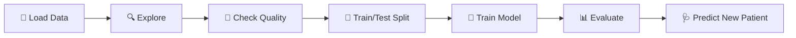

<div align="center">

# 🏥 Healthcare ML Predictions

### Teaching machines to spot disease early: 3 classification projects on real patient data

<br>


<br>

[**❤️ Heart Disease**](./heart-disease-prediction) &nbsp;·&nbsp; [**🩸 Diabetes**](./diabetes-prediction) &nbsp;·&nbsp; [**🎗️ Breast Cancer**](./breast-cancer-prediction)

</div>

---

## ✨ The Idea

Early detection saves lives. In each project here, a model reads a patient's medical measurements and answers one question: **is the disease present or not?**

All three projects follow the same clear workflow, so you can compare how different data and models behave:



---

## 📊 Results at a Glance

| | Project | Predicts | Data | Model | Test Accuracy |
|:-:|---|---|---|---|:-:|
| ❤️ | [**Heart Disease**](./heart-disease-prediction) | Healthy vs defective heart | 303 patients · 13 features | Logistic Regression | **80.3%** |
| 🩸 | [**Diabetes**](./diabetes-prediction) | Diabetic vs non-diabetic | 768 patients · 8 features | SVM (linear) | **77.3%** |
| 🎗️ | [**Breast Cancer**](./breast-cancer-prediction) | Malignant vs benign tumour | 569 patients · 30 features | Logistic Regression | **93.9%** |

```
Heart Disease  ████████████████░░░░  80.3%
Diabetes       ███████████████░░░░░  77.3%
Breast Cancer  ███████████████████░  93.9%
```

> ℹ️ These are different datasets with different models, so the scores should not be ranked against each other. Each number only shows how well that model did on **its own unseen test data**.

---

## 🔬 Project Spotlights

### ❤️ Heart Disease Prediction
> *Can 13 basic medical measurements reveal a heart problem?*

- **Data:** 303 patients, age, cholesterol, chest pain type, max heart rate and more
- **Approach:** Logistic Regression with a **stratified split**, so train and test keep the same healthy / defective balance
- **Result:** 83.9% train vs **80.3% test**, a small gap, so no heavy overfitting
- 👉 [Read the full project](./heart-disease-prediction)

### 🩸 Diabetes Prediction
> *Which health signals separate diabetic patients from the rest?*

- **Data:** 768 patients, 8 features, about 65% non-diabetic and 35% diabetic
- **Approach:** **Standardised features** + a linear SVM, since SVMs are sensitive to scale
- **Insight:** **Glucose** shows the clearest gap, averaging about **141** for diabetic vs **110** for non-diabetic patients
- **Result:** 78.7% train vs **77.3% test**
- 👉 [Read the full project](./diabetes-prediction)

### 🎗️ Breast Cancer Prediction
> *Can cell measurements tell a malignant tumour from a benign one?*

- **Data:** 569 patients, 30 measurements of cell nuclei (357 benign, 212 malignant)
- **Insight:** Malignant tumours are clearly larger, with a **mean radius of about 17.5 vs 12.1**
- **Result:** 94.5% train vs **93.9% test**, the strongest of the three
- 👉 [Read the full project](./breast-cancer-prediction)

---

## 🧰 Tech Stack

| Area | Tools |
|---|---|
| **Language** | Python |
| **Data handling** | Pandas, NumPy |
| **Machine learning** | scikit-learn: Logistic Regression, SVM, StandardScaler, train/test split |
| **Environment** | Jupyter Notebook |

## 🎓 Skills Practised

- ✅ End-to-end ML workflow on real medical data
- ✅ Exploring data with `describe`, `groupby` and class-balance checks
- ✅ Stratified splitting and feature standardisation
- ✅ Reading **train vs test accuracy** to judge overfitting
- ✅ Building a simple **predictive system** for a single new patient

---

## 🚀 Quick Start

```bash
# 1. Clone the repository
git clone https://github.com/aditya-datahub/healthcare-ml-predictions.git
cd healthcare-ml-predictions

# 2. Install dependencies for all projects
pip install -r requirements.txt

# 3. Open any project's notebook
cd heart-disease-prediction
jupyter notebook main.ipynb
```

<details>
<summary><b>📁 Repository structure (click to expand)</b></summary>

<br>

```
healthcare-ml-predictions/
├── README.md                    # you are here
├── requirements.txt             # one install for all three projects
├── LICENSE
│
├── heart-disease-prediction/
│   ├── README.md
│   ├── main.ipynb
│   ├── heart_disease_data.csv
│   └── requirements.txt
│
├── diabetes-prediction/
│   ├── README.md
│   ├── main.ipynb
│   ├── diabetes.csv
│   └── requirements.txt
│
└── breast-cancer-prediction/
    ├── README.md
    ├── main.ipynb
    ├── data.csv
    └── requirements.txt
```

</details>

---

## 🛣️ Roadmap

These are first-version projects, and I know exactly where they can grow:

- [ ] Add **recall, precision, F1 and confusion matrices**. In healthcare, missing a sick patient is the costly mistake, so accuracy alone is not enough
- [ ] Compare more models (Random Forest, KNN, XGBoost) with **cross-validation**
- [ ] Diabetes: replace invalid zero values with proper missing-value handling and apply the scaler in the prediction step
- [ ] Add EDA charts (correlation heatmaps, distributions) and feature importance

---

> ⚠️ **Disclaimer:** These are learning projects, not medical tools. Do not use them for real diagnosis.

<div align="center">

### 👋 Built by **Aditya Sharma**

Data Analyst · SQL · Python · Power BI

[](https://github.com/aditya-datahub)
[](https://www.linkedin.com/in/aditya-sharma-data-analyst)

⭐ **If you found this useful, consider starring the repo!**

</div>
