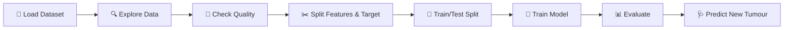

<div align="center">

# 🎗️ Breast Cancer Prediction

### Can a machine learning model tell a malignant tumour from a benign one using 30 cell measurements?


</div>

---

## 📌 TL;DR

| | |
|---|---|
| **Goal** | Classify a tumour as **Malignant (0, cancerous)** or **Benign (1, non-cancerous)** |
| **Data** | 569 patients · 30 numeric features · 0 missing values |
| **Model** | Logistic Regression |
| **Test accuracy** | **93.9%** on 114 patients the model had never seen |
| **Bonus** | A mini *predictive system*: enter one tumour's 30 measurements, get an instant answer |

> 🌱 This was an early project from my ML learning phase. I built it to practise the full workflow on a real medical dataset, from loading data to making a prediction.

---

## 🔄 What I Did, End to End



### 1️⃣ Loaded the data
Used the Breast Cancer Wisconsin dataset that ships with scikit-learn (`load_breast_cancer()`) and converted it into a Pandas DataFrame with the 30 feature columns plus a `label` column.
Final shape: **569 rows × 31 columns**.

### 2️⃣ Explored it
Looked at `head()`, `shape`, `info()` and `describe()`. All 30 features are decimal numbers (`float64`).

### 3️⃣ Checked data quality
Ran `isnull().sum()`: **zero missing values** in every column, so no cleaning was needed.

### 4️⃣ Checked the target balance
The classes are not perfectly even: benign cases outnumber malignant ones.

| Label | Meaning | Patients | Share |
|---|---|---|---|
| `1` | Benign (non-cancerous) | 357 | 63% |
| `0` | Malignant (cancerous) | 212 | 37% |

### 5️⃣ Compared the two groups
`df.groupby('label').mean()` shows that malignant tumours are clearly larger on average. For example, **mean radius is about 17.5 for malignant vs 12.1 for benign**, and mean area is about 978 vs 463. This is a good sign that the features carry real signal.

### 6️⃣ Separated features and label and split the data
```python
x = df.drop('label', axis=1)   # 30 input features
y = df['label']                # what we want to predict

x_train, x_test, y_train, y_test = train_test_split(
    x, y, test_size=0.2, random_state=2
)
```
80% for training (455 patients), 20% held back for testing (114 patients).

### 7️⃣ Trained the model
```python
model = LogisticRegression()
model.fit(x_train, y_train)
```

### 8️⃣ Evaluated it

| Dataset | Accuracy |
|:---|:---:|
| 🏋️ Training data | **94.5%** |
| 🧪 Test data (unseen) | **93.9%** |

The two scores are very close (a gap of about 0.7 points), so the model is **generalising well and not just memorising** the training data.

### 9️⃣ Built a predictive system 🩺
Wrote a small block that takes one tumour's 30 measurements, reshapes them for the model and prints a readable result:

```python
# → Malignant --> Cancerous
```
The sample input I tested is the first record of the dataset, which is a known malignant case, and the model classified it correctly.

---

## 🧬 About the Features

<details>
<summary><b>Click to expand</b></summary>

<br>

The 30 features come from digitised images of a fine needle aspirate of a breast mass. They describe the **cell nuclei** in the image. For each of 10 base measurements, the dataset gives 3 values (mean, error, worst):

| Base measurement | What it describes |
|---|---|
| radius | Average distance from the centre to the edge |
| texture | Variation in grey-scale values |
| perimeter | Size of the outline |
| area | Size of the nucleus |
| smoothness | Local variation in radius lengths |
| compactness | Perimeter² / area − 1 |
| concavity | Severity of concave parts of the outline |
| concave points | Number of concave parts of the outline |
| symmetry | How symmetric the shape is |
| fractal dimension | "Coastline" complexity of the outline |

10 measurements × 3 (mean, error, worst) = **30 features**.

</details>

---

## 🎓 What I Learned

- Running the full pipeline on a real medical dataset: **load → explore → check → split → train → evaluate → predict**
- Reading **training vs test accuracy** to judge overfitting
- Using **`groupby`** to see how two classes differ before modelling
- Turning a trained model into a simple **prediction tool**

## 🚀 What I'd Improve Next

This is a first-version project, and I know where it can grow:

- [ ] **Add recall, precision, F1 and a confusion matrix.** The classes are imbalanced (63/37), and in cancer detection, missing a malignant tumour is the costly mistake, so recall on the malignant class matters more than accuracy.
- [ ] Use `stratify=y` in the split so both sets keep the same class ratio
- [ ] **Scale the features** (`StandardScaler`) and fix the convergence warning
- [ ] Compare with **Random Forest, SVM, KNN** using cross-validation
- [ ] Add EDA charts (correlation heatmap, feature distributions) and feature importance

---

## 📁 Project Structure

```
breast-cancer-prediction/
├── README.md          # you are here
├── main.ipynb         # full notebook: load → explore → model → prediction
├── data.csv           # a CSV copy of the Breast Cancer Wisconsin data (reference)
└── requirements.txt   # Python dependencies
```

> 📝 The notebook loads the dataset directly from scikit-learn, so it does not need `data.csv` to run. The CSV is included for reference.

## ▶️ Run It Yourself

```bash
# 1. Clone the repo
git clone https://github.com/aditya-datahub/healthcare-ml-predictions.git
cd healthcare-ml-predictions/breast-cancer-prediction

# 2. Install dependencies
pip install -r requirements.txt

# 3. Open the notebook
jupyter notebook main.ipynb
```

---

> ⚠️ **Disclaimer:** This is a learning project, not a medical tool. Do not use it for real diagnosis.

<div align="center">

**Built by [Aditya Sharma](https://github.com/aditya-datahub)** · [LinkedIn](https://www.linkedin.com/in/aditya-sharma-data-analyst)

⭐ If you found this useful, consider starring the repo!

</div>
