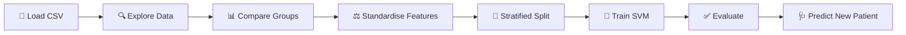

<div align="center">

# 🩸 Diabetes Prediction

### Can a machine learning model predict diabetes from 8 simple health measurements?


</div>

---

## 📌 TL;DR

| | |
|---|---|
| **Goal** | Predict whether a patient is **Diabetic (1)** or **Non-Diabetic (0)** |
| **Data** | 768 patients · 8 health features · 268 diabetic, 500 non-diabetic |
| **Model** | Support Vector Machine (linear kernel) with standardised features |
| **Test accuracy** | **77.3%** on 154 patients the model had never seen |
| **Bonus** | A mini *predictive system*: enter one patient's values, get an instant answer |

> 🌱 This was an early project from my ML learning phase. I built it to practise a new model (SVM) and to learn why **feature scaling** matters.

---

## 🔄 What I Did, End to End



### 1️⃣ Loaded and explored the data
Read the CSV with Pandas and checked `head()`, `shape` and `describe()`. The dataset has **768 rows and 9 columns** (8 features + the `Outcome` label).

### 2️⃣ Checked the target balance
Non-diabetic patients outnumber diabetic ones by about 2 to 1.

| Outcome | Meaning | Patients | Share |
|---|---|---|---|
| `0` | Non-diabetic | 500 | 65% |
| `1` | Diabetic | 268 | 35% |

### 3️⃣ Compared diabetic vs non-diabetic patients
`groupby('Outcome').mean()` shows a clear pattern. The biggest gap is in **glucose**.

| Feature (average) | Non-diabetic | Diabetic |
|---|:---:|:---:|
| Glucose | 110.0 | **141.3** |
| BMI | 30.3 | **35.1** |
| Pregnancies | 3.3 | **4.9** |
| Insulin | 68.8 | **100.3** |

So diabetic patients tend to have higher glucose, higher BMI and more pregnancies, which is a good sign that the features carry real signal.

### 4️⃣ Standardised the features
The features sit on very different scales (Insulin goes into the hundreds, while DiabetesPedigreeFunction is below 1). SVM is sensitive to scale, so I used `StandardScaler` to put every feature on the same scale.
```python
scaler = StandardScaler()
standardized_data = scaler.fit_transform(x)
```

### 5️⃣ Split into train and test sets
80% to learn from (614 patients), 20% kept hidden for testing (154 patients). I used `stratify=y` so both sets keep the same diabetic / non-diabetic ratio.
```python
x_train, x_test, y_train, y_test = train_test_split(
    x, y, test_size=0.2, stratify=y, random_state=2
)
```

### 6️⃣ Trained the model
```python
classifier = svm.SVC(kernel='linear')
classifier.fit(x_train, y_train)
```

### 7️⃣ Evaluated it

| Dataset | Accuracy |
|:---|:---:|
| 🏋️ Training data | **78.7%** |
| 🧪 Test data (unseen) | **77.3%** |

The two scores are close (a gap of about 1.4 points), so the model is **not overfitting**. It generalises about as well as it learns.

### 8️⃣ Built a predictive system 🩺
Wrote a small block that takes one patient's 8 values and prints a readable result:
```python
input_data = (10, 168, 74, 0, 0, 38, 0.537, 34)
# → The person is Diabetic
```

---

## 🧬 The 8 Features Used

<details>
<summary><b>Click to expand the feature guide</b></summary>

<br>

| Feature | Meaning |
|---|---|
| `Pregnancies` | Number of times pregnant |
| `Glucose` | Plasma glucose concentration |
| `BloodPressure` | Diastolic blood pressure (mm Hg) |
| `SkinThickness` | Triceps skin fold thickness (mm) |
| `Insulin` | 2-hour serum insulin (mu U/ml) |
| `BMI` | Body mass index |
| `DiabetesPedigreeFunction` | A score for family history of diabetes |
| `Age` | Age in years |

</details>

---

## 🎓 What I Learned

- Why **feature scaling** matters for distance-based models like SVM
- How to use **stratified splitting** when classes are imbalanced (65 / 35)
- How to read **training vs test accuracy** to spot overfitting
- How to use `groupby` to understand a dataset before modelling

## ⚠️ Known Limitations

Being honest about what this version does not do yet:

- **Zeros that are really missing values.** Columns like `Insulin` (374 rows), `SkinThickness` (227), `BloodPressure` (35), `BMI` (11) and `Glucose` (5) contain `0`, which is not a valid medical reading. These are missing values stored as zero, and I did not clean them in this version.
- **The predictive system skips scaling.** The model was trained on standardised data, but the sample input in the prediction block is passed in raw (the scaling lines are commented out). The correct way is to run the input through `scaler.transform()` first. For this sample both give the same answer (Diabetic), but it is a bug in principle.
- **Only accuracy is reported.** With 65 / 35 classes, accuracy alone can hide problems. In healthcare, missing a diabetic patient is the costly mistake, so **recall** matters more.

## 🚀 What I'd Improve Next

- [ ] Replace the invalid zeros with the column **median** (or `NaN` and impute)
- [ ] Fix the predictive system to use `scaler.transform()`
- [ ] Add **recall, precision, F1 and a confusion matrix**
- [ ] Compare with **Logistic Regression, Random Forest, KNN** using cross-validation
- [ ] Add EDA charts (correlation heatmap, glucose distribution)

---

## 📁 Project Structure

```
diabetes-prediction/
├── README.md          # you are here
├── main.ipynb         # full notebook: EDA → scaling → SVM → prediction
├── diabetes.csv       # dataset (768 rows × 9 columns)
└── requirements.txt   # Python dependencies
```

## ▶️ Run It Yourself

```bash
# 1. Clone the repo
git clone https://github.com/aditya-datahub/healthcare-ml-predictions.git
cd healthcare-ml-predictions/diabetes-prediction

# 2. Install dependencies
pip install -r requirements.txt

# 3. Open the notebook
jupyter notebook main.ipynb
```

---

> ⚠️ **Disclaimer:** This is a learning project, not a medical tool. Do not use it for real diagnosis.

<div align="center">

**Built by [Aditya Sharma](https://github.com/aditya-datahub)** · [LinkedIn](https://www.linkedin.com/in/aditya-sharma-data-analyst)

⭐ If you found this useful, consider starring the repo!

</div>
